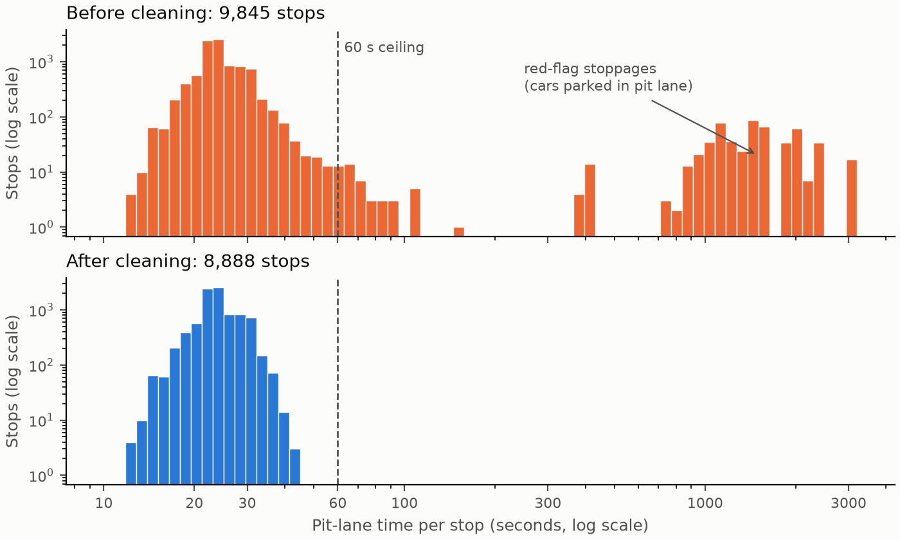

# 3. Changes after Data Preparation

All numbers come from `src/before_after.py`. **Before** means the 2014–2026 rows of the raw table with their raw pit stops. **After** means the cleaned tables from Section 2.

## Overview

| | Before | After | Change |
|---|---:|---:|---|
| Driver-race rows | 5,457 | 5,385 | −72 (−1.3%) |
| Races | 268 | 267 | 2021 Belgian GP removed |
| Columns | 27 | 32 | +5: `top_team`, `street`, `finish_cat`, `winner`, `pit_delta_s` |
| Pit stops | 9,845 | 8,888 | −957 (−9.7%) |
| Grid range | 0–22 | 1–22 | pit-lane code 0 removed |
| Duplicate (race, driver) rows | 0 | 0 | none in this era (89 in the 1950s) |

**Observation:** cleaning removed only 1.3% of driver-race rows but 9.7% of pit stops. The race results were already clean; the pit-stop times were not.

## 1. Data types

| Column | Before | After |
|---|---|---|
| `date` | text | date |
| `is_classified` | text `"t"`/`"f"` | boolean |
| `pit_stops` | decimal with blanks | whole number, no blanks |
| group labels | did not exist | 4 new columns |

**Observation:** with the right types, filters such as "classified finishers" or "2014–2019" are exact comparisons, not text matching. Every test group is now a column fixed in advance.

## 2. Missing values

| Column | Before | After | Why it changed |
|---|---:|---:|---|
| `pit_stops` | 380 | **0** | Blank = no stop, so filled with 0 |
| `race_time_s` | 1,953 | 1,911 | Only rows removed; nothing imputed |
| `fastest_lap_rank` | 33 | 33 | Left as is |
| `mean_pit_s` | 380 | 460 | +111 driver-races whose only stops were outliers, minus the 31 no-stop rows that were removed |
| `pit_delta_s` | – | 460 | New column, same rows as `mean_pit_s` |
| **Total blank cells** | 2,746 | 2,864 | |

**Observation:** the number of blank cells **went up**, and that is correct. A red-flag "stop" of 2,000 s was a wrong value pretending to be real. It is now honestly marked as missing, so those drivers are left out of the pit tests instead of skewing them.

## 3. Grid and finishing position (Tests A, B, E)

| | Before | After |
|---|---:|---:|
| Classified finishers | 4,618 | 4,557 |
| Pearson r (grid vs finish) | 0.717 | **0.745** |
| Spearman ρ (grid vs finish) | 0.726 | **0.754** |
| Pole-sitter win rate | 54.5% (268 races) | 54.3% (267 races) |

**Observation:** removing 52 pit-lane starts **raised the grid–finish correlation by 0.03**. Those cars were coded as grid 0, which looks better than pole, yet they finish in the midfield, so they pulled the correlation down. After cleaning, r² rises from 0.51 to 0.56: grid position explains about 56% of the variation in finishing order instead of 51%. The pole-win rate barely moves, because removing Spa 2021 removes only one pole and one win.

## 4. Finish categories (Test C)

| Category | Before | After |
|---|---:|---:|
| Podium (P1–3) | 804 | 801 |
| Points (P4–10) | 1,876 | 1,859 |
| No points | 1,938 | 1,897 |
| Retired / not classified | 839 | 828 |

**Observation:** the shares hardly change (podium 14.7% → 14.9%, retired 15.4% → 15.4%). The changes come from the removed rows and from the 3 disqualified drivers who are now correctly counted as not classified. Test C's contingency table rests on the same picture before and after cleaning.

## 5. Pit-stop durations (Tests D, F): the biggest change

| Per stop | Before | After |
|---|---:|---:|
| Count | 9,845 | 8,888 |
| Mean | 105.6 s | **24.2 s** |
| Median | 24.0 s | 23.6 s |
| Standard deviation | 358.2 s | **3.8 s** |
| Maximum | 3,069.0 s | 44.7 s |
| Skewness | 4.78 | 0.61 |
| Excess kurtosis | 23.7 | 1.0 |
| Stops over 60 s | 583 | 0 |

*Takeaway: the raw data held two populations, real stops of 12–45 s and red-flag stoppages of about 6–51 minutes. Cleaning keeps only the first.*

**Observations:**

- **The mean was meaningless before cleaning.** At 105.6 s it was 4.4 times the median, because 6% of the "stops" were cars parked for up to 51 minutes. After cleaning, mean and median agree (24.2 vs 23.6 s).
- **The spread fell almost 100-fold** (SD 358 → 3.8 s). Any test of variances (Test F) on the raw data would have measured red flags, not pit crews.
- **The shape is now close to symmetric.** Skewness fell from 4.78 to 0.61 and excess kurtosis from 23.7 to 1.0, so t- and F-tests, which assume roughly normal data, become reasonable. A mild right skew remains, which is why Tests D and F keep the Mann-Whitney and Levene checks.

## 6. What the outliers would have done to the tests

Each stop's delta is its time minus that race's median stop, averaged by group:

| Group comparison | Before | After |
|---|---:|---:|
| Top 4 teams, mean delta | +51.71 s (SD 333.2) | **+0.12 s** (SD 2.01) |
| Other teams, mean delta | +50.14 s (SD 333.4) | **+0.57 s** (SD 2.12) |
| Race winners, mean delta | +64.17 s | **−0.40 s** |
| Non-winners, mean delta | +50.06 s | **+0.43 s** |

**Observation:** this is the most important result of the cleaning. On the raw data, **race winners appear to pit 14 s *slower* than everyone else**. In reality they are about **0.8 s faster**: the direction of the effect is **reversed**. The likely reason: when a race is red-flagged, every car still running logs a red-flag "stop". A winner is always still running, while the non-winner group includes cars that had already retired and so never logged one. Without cleaning, Test D would have reached the opposite conclusion. Likewise, the top teams and the rest look identical on raw data (51.7 vs 50.1 s, SDs of 333 s), because the difference is buried under the noise. After cleaning, a gap of 0.45 s becomes measurable.
