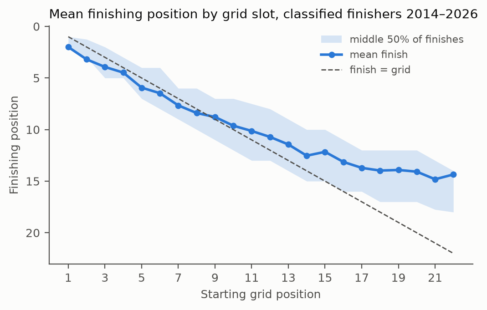
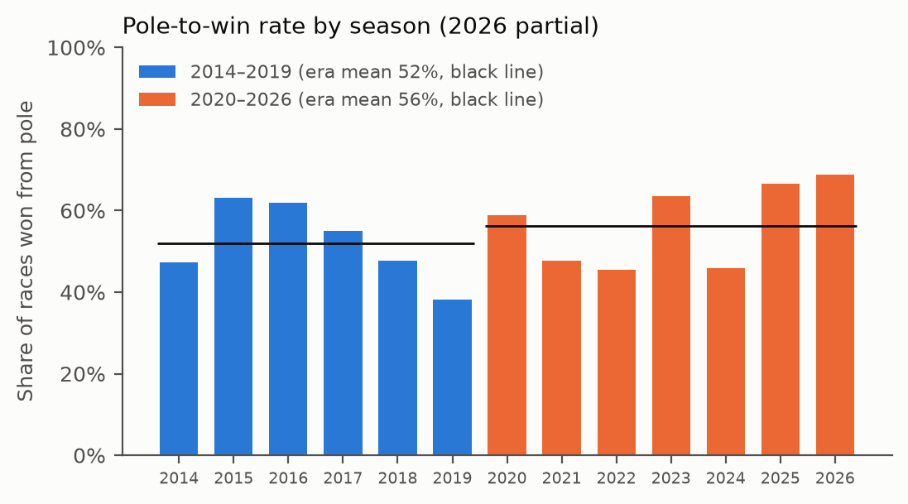
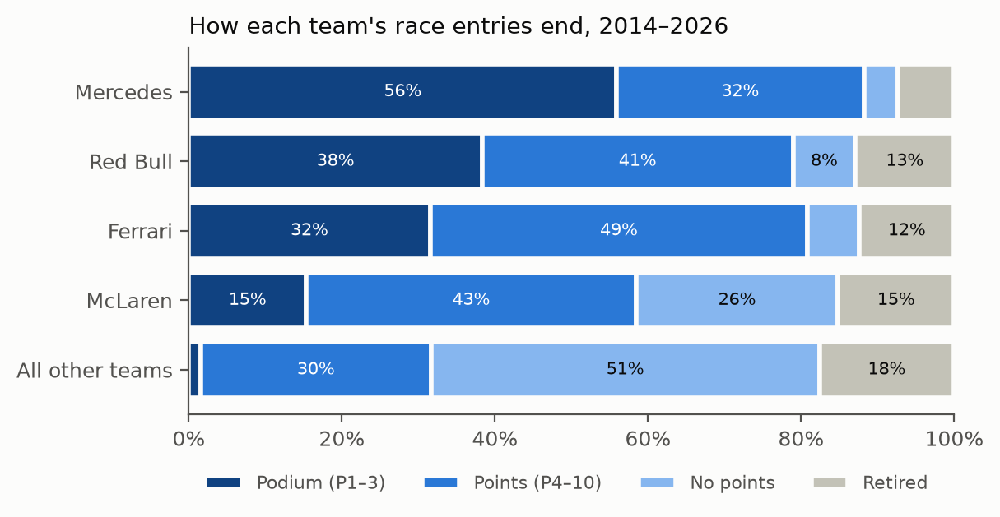
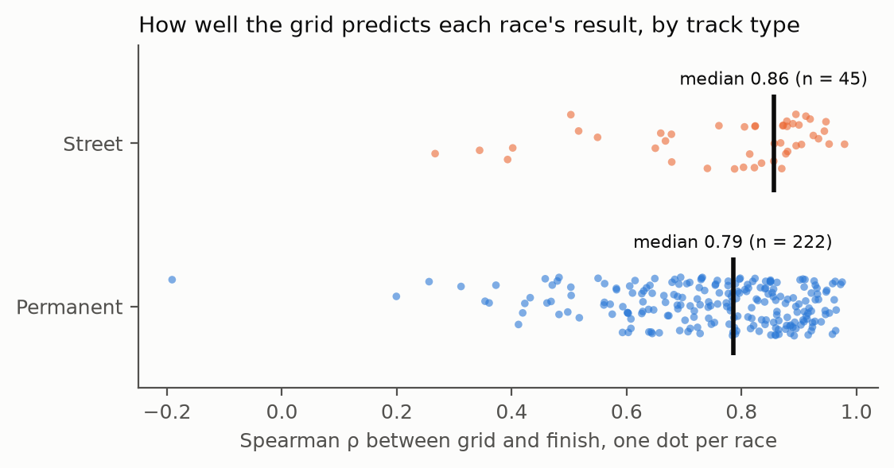
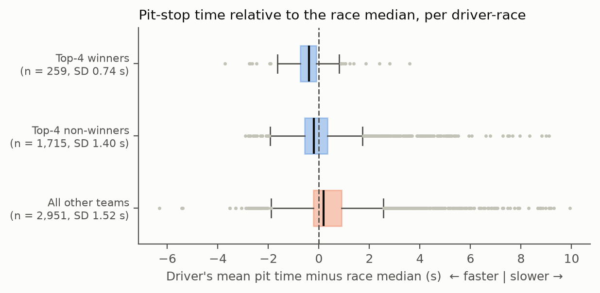

# 4. Questions, Problem Statement and EDA

## Basic questions about the data

These are the questions anyone would ask of an F1 results table first. All answers are for the cleaned hybrid-era data (2014–2026, 267 races).

| Basic question | Answer from the data |
|---|---|
| Who wins the most? | Hamilton 84 wins, Verstappen 71, Rosberg 20. Only 16 different drivers won a race in 13 seasons |
| Which teams dominate? | Mercedes 129 wins, Red Bull 83, Ferrari 29, McLaren 23. These **4 teams won 264 of 267 races (98.9%)** and scored 80% of all points |
| How often does pole position win? | 145 of 267 races (54.3%) |
| How often do cars retire? | 15.4% of entries. The rate fell from about 20% in 2014–2017 to 10–12% in 2023–2025 |
| How long is a pit stop? | The median pit-lane time is 23.6 s. It has barely changed (24.2 s in 2014, 23.0 s in 2025) |
| Why do cars retire? | Most often "Retired" (unspecified), collisions, accidents and engine failures |

These questions are **descriptive**: each is answered by a count or an average and says nothing about whether a difference is real or how large it is.

## Our problem statement

> **In the hybrid era, how much do qualifying position, team, era, pit-crew performance and track type each shape a Formula 1 result, and is each effect large enough to matter in a real race?**

### How it goes beyond the basic questions

1. **From counting to inference.** "Pole wins 54% of the time" is a fact about one sample. We ask whether the rate *changed* between eras and whether that change is larger than sampling noise, using a confidence interval and a pre-set **smallest difference that matters** (for example 10 percentage points). A significant result that is too small to matter is reported as such.
2. **A fair pit-stop measure.** Raw pit times mostly measure the *pit lane*: the race median ranges from 16 s to 37 s depending on the track. We subtract each race's median stop, so every stop is measured relative to the same field on the same day. Section 3 showed that without this cleaning the main pit-stop conclusion **reverses**.
3. **The right unit for track type.** Pooling all drivers at Monaco would count one race 20 times. Test E reduces each race to **one number**, its grid-to-finish correlation, and compares street and permanent races, so each race is one independent observation.
4. **Assumptions are tested, not assumed.** Each test is paired with a robustness check (Spearman, Mann-Whitney) chosen from what the EDA below shows about the data's shape.

## EDA plots

### Plot 1: Grid position vs finishing position (Test A)

**Takeaway:** the grid strongly orders the result (r = 0.745, so the grid explains about 56% of finishing variation). Pole-sitters average P2.0, and the curve flattens at the back: 83% of classified finishers who started P15 or lower gain places, mostly because cars ahead retire.

*Effect on the tests:* the relationship bends at the back and positions are ranks, so Test A keeps Spearman as its robustness check.

### Plot 2: Pole-to-win rate by season (Test B)

**Takeaway:** the pole-win rate rose from 52% (63/121) in 2014–2019 to 56% (82/146) in 2020–2026. That 4-point gap is smaller than the year-to-year swings (38% to 69%) and smaller than our 10-point threshold.

*Effect on the tests:* Test B will most likely show **no meaningful era change**. That is still a finding, because the rule changes since 2020 did not make pole position more decisive.

### Plot 3: How each team's entries end (Test C)

**Takeaway:** a Mercedes entry ended on the podium 56% of the time; an entry from outside the top 4 did so 1.6% of the time. Mercedes also retired least (7% vs 18% for the rest), so team and outcome look strongly linked. McLaren's profile sits between the big three and the rest.

*Effect on the tests:* every cell has well over 5 expected entries, so the chi-square test's condition holds. Test C is about *how strong* the link is (Cramér's V), not whether it exists.

### Plot 4: Grid-to-finish correlation per race, street vs permanent (Test E)

**Takeaway:** on street circuits the grid predicts the result *better*, not worse: the median per-race ρ is 0.86 on street tracks and 0.79 on permanent ones. Narrow street tracks make overtaking hard, so races stay in grid order.

*Effect on the tests:* this goes against the common belief that street races are chaotic, which is why Test E is **two-sided**. Correlations are bounded at 1 and skewed left, so the Fisher z-transform is applied before the Welch t-test. There are 45 street races against 222 permanent ones, a strong imbalance that rules out the pooled t-test.

### Plot 5: Pit-stop time relative to the race median (Test D)

**Takeaway:** race winners' stops are 0.41 s faster than their race's median on average, other top-4 drivers' 0.16 s slower, and the rest's 0.56 s slower. Winners are also far more consistent (SD 0.74 s against 1.40 s and 1.52 s).

*Effect on the tests:*
- **Test D (mean):** winners vs top-4 non-winners differ by about 0.57 s, above the 0.3 s threshold. The groups are very unequal in size (259 vs 1,715) and have very different spreads, which is exactly the case for **Welch's t-test** rather than the pooled test.

