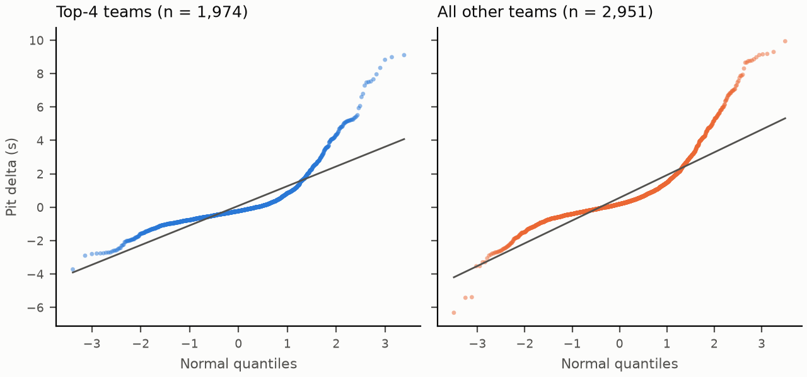

# 5. Statistical Inference

All numbers come from `src/tests.py` and are saved in `data/test_results.csv`. Six tests were planned, and every choice in parts (a) and (b) was fixed in the plan before any test was run.

## Common setup

- **Data:** the cleaned hybrid-era table (Section 2): 5,385 driver-races in 267 races, 2014–2026.
- **Significance level:** α = 0.05, two-sided unless stated otherwise. All intervals are 95%.
- **Multiple testing:** Holm–Bonferroni over the m tests reported. Sort the p-values and reject the k-th smallest while p₍ₖ₎ ≤ α / (m − k + 1).
- **Practical significance:** each test has a threshold δ, the smallest difference that would matter in a real race. With the 95% CI [L, U]:

| CI position | Verdict |
|---|---|
| Inside (−δ, δ) | **Negligible** |
| Excludes 0 but reaches inside (−δ, δ) | **Significant, possibly small** |
| Entirely beyond ±δ | **Matters** |
| Contains 0 and extends beyond ±δ | **Inconclusive** |

---

## Test A: Does grid position predict finishing position?

### (a) Before running

| | |
|---|---|
| Unit | One classified finisher: grid x, finishing position y (n = 4,557) |
| Hypotheses | H₀: ρ = 0 &nbsp; vs &nbsp; H₁: ρ ≠ 0 |
| Level, sides | α = 0.05, two-sided |
| Test | t-test for Pearson's correlation: t = r√(n−2) / √(1−r²), df = n − 2 |
| Smallest difference that matters | r² ≥ 0.10: grid explains at least 10% of finishing variation |

### (b) Other tests considered

| Test | Why not the main test |
|---|---|
| Spearman rank correlation | Positions are ranks, so it is a natural fit, but its CI is less standard. **Used as a robustness check** |
| Regression slope t-test | Gives the same t and p, but answers "places per grid slot" rather than strength. **Reported** for interpretation |
| Within-race permutation test | Respects that drivers in one race share conditions, but gives no CI. **Used as a check** |
| z-test for correlation | Requires a known σ, which we do not have |

### (c) Results

| Statistic | df | p | Decision | r [95% CI] | r² [95% CI] |
|---|---:|---|---|---|---|
| t = 75.37 | 4,555 | < 10⁻³⁰⁰ | **Reject H₀** | 0.745 [0.732, 0.758] | 0.555 [0.536, 0.574] |

The CI uses Fisher's transform, z = ½ ln((1+r)/(1−r)) with SE 1/√(n−3), back-transformed with tanh.

- **Robustness:** Spearman ρ = 0.754 (p < 10⁻³⁰⁰). In the within-race permutation test (9,999 shuffles), the largest |r| under H₀ was 0.064, far below 0.745 (p = 0.0001, the smallest possible with 9,999 shuffles).
- **Slope:** 0.650 [0.633, 0.667]. Each grid slot further back costs about **0.65 finishing places** on average. The slope is below 1 because retirements ahead let cars further back gain places.
- **Is it large enough to matter?** Yes. The whole r² CI [0.536, 0.574] lies above δ = 0.10, so grid position explains more than half of finishing variation. **Verdict: matters.**
- **Limitations:** drivers in the same race are not independent; the permutation test addresses this, and the result survives. Only classified finishers are included, so this measures order *among finishers* and says nothing about whether a front-row car retires.

---

## Test B: Has the pole-position win rate changed between eras?

### (a) Before running

| | |
|---|---|
| Unit | One race. W = 1 if the pole-sitter won |
| Groups | 2014–2019 (n₁ = 121) vs 2020–2026 (n₂ = 146) |
| Hypotheses | H₀: p₁ = p₂ &nbsp; vs &nbsp; H₁: p₁ ≠ p₂ |
| Level, sides | α = 0.05, two-sided |
| Test | Two-proportion z-test with a pooled rate |
| Smallest difference that matters | δ = 0.10 (10 percentage points) |

### (b) Other tests considered

| Test | Why not the main test |
|---|---|
| Chi-square test on the 2×2 table | Identical (χ² = z², df 1), but gives no direction or CI. **Checked** |
| Fisher's exact test | Needed only if a count is small. All counts are ≥ 58. **Checked** |
| One-proportion z-test | Asks whether pole wins 50% of races, a different question |
| t-test on 0/1 data | The variance depends on the mean for 0/1 data, so the z-test is the proper tool |

### (c) Results

| | Wins / races | Rate |
|---|---:|---:|
| 2014–2019 | 63 / 121 | 52.1% |
| 2020–2026 | 82 / 146 | 56.2% |
| Pooled | 145 / 267 | 54.3% |

| Statistic | p | Decision | p₁ − p₂ [95% CI] | Cohen's h |
|---|---|---|---|---|
| z = −0.669 | 0.503 | **Fail to reject H₀** | −0.041 [−0.161, +0.079] | −0.082 |

- **Condition:** each group has at least 10 successes and 10 failures (63/58 and 82/64). ✔
- **Robustness:** χ² = 0.448 = z², p = 0.503. Fisher's exact test p = 0.538.
- **Is it large enough to matter?** We cannot tell. The CI contains 0 but also reaches −16 points, beyond δ = 10. **Verdict: inconclusive.** Cohen's h = 0.08 is "negligible" on Cohen's scale, but the CI is too wide to rule out a real 10-point change.
- **Why so wide:** there are only 267 races. Detecting a 10-point difference with 80% power would need about (1.96 + 0.84)² × 2 × 0.25 / 0.10² ≈ **390 races per era**, about three times what we have. The season-to-season rate swings from 38% (2019) to 69% (2026), which also hides any era effect.
- **Limitations:** an era also bundles which car dominated it (Mercedes in 2014–2020, Red Bull in 2022–2023), so even a significant result would reflect eras, not the rules alone.

---

## Test C: Do the top teams finish races differently?

### (a) Before running

| | |
|---|---|
| Unit | One driver-race for the top 4 constructors (N = 2,127) |
| Categories | Podium (P1–3), points (P4–10), no points, retired |
| Hypotheses | H₀: constructor and finish category are independent &nbsp; vs &nbsp; H₁: they are associated |
| Level, sides | α = 0.05. The rejection region is the upper tail only |
| Test | Chi-square test of independence, df = (4−1)(4−1) = 9 |
| Smallest difference that matters | Cramér's V ≥ 0.10 |

### (b) Other tests considered

| Test | Why not the main test |
|---|---|
| One z-test per category | 4+ tests on overlapping data, which inflates the false-positive rate |
| Fisher's exact test (r×c) | Needed only when expected counts are small. The smallest expected count is 60.5 |
| Chi-square goodness of fit | Compares one distribution with a fixed benchmark, not teams with each other |
| G-test (likelihood ratio) | An asymptotically equivalent alternative. **Checked** |

### (c) Results

Observed counts (row %):

| | Podium | Points | No points | Retired | Total |
|---|---:|---:|---:|---:|---:|
| Mercedes | 298 (55.9%) | 172 (32.3%) | 24 (4.5%) | 39 (7.3%) | 533 |
| Red Bull | 202 (38.3%) | 214 (40.6%) | 43 (8.2%) | 68 (12.9%) | 527 |
| Ferrari | 168 (31.5%) | 263 (49.3%) | 36 (6.8%) | 66 (12.4%) | 533 |
| McLaren | 82 (15.4%) | 230 (43.1%) | 141 (26.4%) | 81 (15.2%) | 534 |

| Statistic | df | p | Decision | Cramér's V [95% CI] |
|---|---:|---|---|---|
| χ² = 303.75 | 9 | 4.2 × 10⁻⁶⁰ | **Reject H₀** | 0.218 [0.196, 0.244] |

The V CI comes from a bootstrap of 2,000 resamples of driver-races.

- **Condition:** every expected count is ≥ 5; the smallest is 60.5. ✔
- **Largest contributions (O − E)² / E:** McLaren × no points: 103.8 (141 observed vs 61.3 expected). Mercedes × podium: 64.5 (298 vs 187.9). McLaren × podium: 60.0 (82 vs 188.3). Mercedes × no points: 22.6 (24 vs 61.1). These four cells give 82% of χ².
- **Robustness:** G-test G = 292.77, df 9, p = 8.9 × 10⁻⁵⁸.
- **Is it large enough to matter?** Yes. The whole V CI lies above 0.10. With min(r−1, c−1) = 3, Cohen's benchmarks for V are 0.06 (small), 0.17 (medium) and 0.29 (large), so V = 0.22 is a **medium** association. **Verdict: matters.**
- **Real-world reading:** the association comes from the two ends of the table. Mercedes converts entries into podiums and rarely misses the points, while McLaren misses the points far more often than expected: it missed the points in 38–50% of entries a season in 2015–2018 and 15–34% in 2019–2023, then in only 4–9% from 2024. Red Bull and Ferrari are close to what independence would predict.
- **Limitations:** team strength changes from season to season, so this pools very different cars under one name. Teammates share a car, so their two entries per race are not independent.

---

## Test D: Do race winners have faster pit stops?

### (a) Before running

| | |
|---|---|
| Unit | One driver-race for the top 4 teams, so car quality is roughly equal. D = mean over the driver's stops of (stop duration − that race's median stop), in seconds |
| Outliers | Stops > 60 s and stops > race median + 10 s removed (Section 2) |
| Groups | Winners W (n = 259) vs top-4 non-winners N (n = 1,715) |
| Hypotheses | H₀: μ_W = μ_N &nbsp; vs &nbsp; H₁: μ_W ≠ μ_N |
| Level, sides | α = 0.05, two-sided |
| Test | Welch's t-test |
| Smallest difference that matters | δ = 0.3 s, roughly a gap that decides a pit-stop undercut |

### (b) Other tests considered

| Test | Why not the main test |
|---|---|
| Pooled two-sample t-test | Assumes equal variances, but the SDs are 0.74 vs 1.40 s (variance ratio 3.6) and the groups are very unequal in size. **Checked**, to show the difference |
| z-test | σ is unknown |
| Paired t-test | There is no natural pairing between winners and non-winners |
| Mann-Whitney U | The data are right-skewed (skew 0.53 and 2.43). **Used as a robustness check** |

### (c) Results

| | n | Mean D | SD | Median |
|---|---:|---:|---:|---:|
| Winners | 259 | −0.408 s | 0.741 | −0.397 s |
| Non-winners | 1,715 | +0.157 s | 1.401 | −0.206 s |

| Statistic | ν (Welch df) | p | Decision | μ_W − μ_N [95% CI] | Cohen's d |
|---|---:|---|---|---|---|
| t = −9.89 | 586.7 | 2.0 × 10⁻²¹ | **Reject H₀** | −0.565 s [−0.677, −0.453] | −0.42 |

- **Robustness:** Mann-Whitney U = 166,332, p = 7.0 × 10⁻¹¹, rank-biserial r = 0.25, so the result is not driven by the slow tail. The pooled t-test gives t = −6.35 (df 1,972). It understates the evidence because its pooled variance is dominated by the larger, noisier group.
- **Is it large enough to matter?** Yes. The whole CI [−0.68, −0.45] lies beyond −0.3 s. Winners' stops are about **0.56 s faster** than those of other top-4 drivers. **Verdict: matters.** Cohen's d = −0.42 is a small-to-medium standardized effect, but in seconds it is larger than a typical undercut margin.
- **Limitations:** this shows association, not cause. Some non-winners lost time *because of* a slow stop, but it can also run the other way: the lead car gets priority, while the second car is sometimes "double-stacked" behind its teammate and waits. Winners may also pit in clear air.

---

## Test E: Does track type change how well grid order predicts the finish?

### (a) Before running

| | |
|---|---|
| Unit | One race. Spearman ρ between grid and finish among classified finishers (races with fewer than 10 finishers skipped; none were), then z = ½ ln((1+ρ)/(1−ρ)) |
| Groups | Street S (Monaco, Singapore, Baku, Jeddah, Las Vegas, Miami; n = 45) vs permanent P (n = 222) |
| Hypotheses | H₀: μ_z,S = μ_z,P &nbsp; vs &nbsp; H₁: μ_z,S ≠ μ_z,P |
| Level, sides | α = 0.05, two-sided |
| Test | Welch's t-test on the z values |
| Smallest difference that matters | δ = 0.10 in z-units |

### (b) Other tests considered

| Test | Why not the main test |
|---|---|
| Separate tests (pole-win z-test, midfield-movement Welch test) | Ask the same question, but each discards information |
| Pooled t-test | The groups are very unequal in size (45 vs 222). **Checked** |
| z-test | σ is unknown |
| Mann-Whitney U | **Used as a robustness check** |
| Circuit-level analysis | Monaco appears 12 times and behaves alike each year. Averaging z per circuit (6 street, 27 permanent) checks that repeated races do not inflate the evidence. **Used as a check** |

### (c) Results

| | Races | Mean z | SD | Mean z as ρ |
|---|---:|---:|---:|---:|
| Street | 45 | 1.181 | 0.436 | 0.828 |
| Permanent | 222 | 1.086 | 0.403 | 0.795 |

| Statistic | ν | p | Decision | μ_S − μ_P [95% CI] | Cohen's d |
|---|---:|---|---|---|---|
| t = 1.353 | 60.2 | 0.181 | **Fail to reject H₀** | +0.095 [−0.046, +0.236] | 0.23 |

- **Robustness:** Mann-Whitney p = 0.095. The pooled t-test gives p = 0.155. At circuit level, the difference shrinks to **+0.013** [−0.273, +0.299] with p = 0.918.
- **Is it large enough to matter?** We cannot tell. The CI contains 0 and also reaches 0.24, beyond δ = 0.10. **Verdict: inconclusive.**
- **Real-world reading:** the point estimate goes against the common belief, since street races follow grid order slightly *more* closely. The circuit-level check shows why this should not be over-read. Street circuits differ a lot from each other: Monaco has a mean ρ of 0.86 over 12 races, while Las Vegas has 0.49 over 3. The race-level gap comes mostly from Monaco appearing many times. "Street circuit" is too broad a label: what matters is the specific track.
- **Limitations:** with 45 street races the test has little power to detect a 0.1 difference. "Street vs permanent" bundles track width, run-off, safety-car frequency and layout, so we claim association only.

---

## Test F: Are the top teams' pit stops more consistent than the rest's?

### (a) Before running

| | |
|---|---|
| Unit | The same D values as Test D, split into top-4 teams T (n = 1,974) and all other teams R (n = 2,951) |
| Hypotheses | H₀: σ²_T = σ²_R &nbsp; vs &nbsp; H₁: σ²_T ≠ σ²_R |
| Level, sides | α = 0.05, two-sided |
| Test | F-test for two variances: F = s²_T / s²_R, df = (n_T − 1, n_R − 1) |
| Smallest difference that matters | A difference of 0.15 s in standard deviation |

### (b) Other tests considered

| Test | Why not the main test |
|---|---|
| Chi-square test for one variance | Compares one sample with a fixed, known σ₀². The rest's variance is estimated, not known |
| Welch's t-test | Answers a question about means, not spread |
| Levene / Brown-Forsythe | More robust to non-normality. **Used as robustness checks**, and important here (see below) |

### (c) Results

| | n | SD of D | IQR | MAD |
|---|---:|---:|---:|---:|
| Top 4 | 1,974 | 1.347 s | 0.857 s | 0.399 s |
| Rest | 2,951 | 1.521 s | 1.115 s | 0.500 s |

| Statistic | df | p | Decision | σ²_T/σ²_R [95% CI] | s_T − s_R [95% CI] |
|---|---|---|---|---|---|
| F = 0.784 | (1,973, 2,950) | 5.1 × 10⁻⁹ | **Reject H₀** | 0.784 [0.724, 0.851] | −0.174 s [−0.300, −0.044] |

The variance-ratio CI is [F / F₀.₉₇₅, F / F₀.₀₂₅]; both critical values are needed because the F distribution is not symmetric. The CI for the SD ratio is [0.851, 0.922]. The CI for the SD difference comes from a bootstrap of 5,000 resamples.

- **Normality check:** see the Q-Q plot below. Both groups have heavy right tails (excess kurtosis 9.2 and 7.4, skew 2.5 and 2.1), so the F-test's normality assumption is **clearly violated**. With heavy tails, the F-test rejects too easily, so its p-value alone cannot be trusted.
- **Robustness:** Levene W = 19.71, df (1, 4,923), p = 9.2 × 10⁻⁶. Brown-Forsythe (median-centred) W = 15.50, p = 8.4 × 10⁻⁵. Both robust tests agree, and so do the outlier-resistant spreads (IQR 23% smaller, MAD 20% smaller for the top teams). The conclusion stands even though the F-test's own p-value is too optimistic.
- **Is it large enough to matter?** Partly. The top teams' SD is 0.17 s smaller, just above δ = 0.15, but the CI [−0.30, −0.04] reaches inside ±0.15. **Verdict: significant, possibly small.** Top crews are more consistent, but we cannot rule out that the gain is below what would matter in a race.

*Takeaway: both groups bend away from the line in the upper tail (occasional slow stops), so the robust Levene and Brown-Forsythe tests are the trustworthy ones.*

---

## Summary and multiple testing

| Test | Statistic (df) | p | Holm p (m = 6) | Estimate [95% CI] | Effect size | Decision | Practical verdict |
|---|---|---|---|---|---|---|---|
| A Grid vs finish | t = 75.37 (4,555) | < 10⁻³⁰⁰ | < 10⁻³⁰⁰ | r = 0.745 [0.732, 0.758] | r² = 0.555 | Reject | **Matters** |
| B Pole by era | z = −0.67 | 0.503 | 0.503 | −0.041 [−0.161, 0.079] | h = −0.08 | Fail to reject | Inconclusive |
| C Team × finish | χ² = 303.75 (9) | 4.2 × 10⁻⁶⁰ | 2.1 × 10⁻⁵⁹ | V = 0.218 [0.196, 0.244] | V = 0.218 | Reject | **Matters** |
| D Pit speed, winners | t = −9.89 (586.7) | 2.0 × 10⁻²¹ | 7.8 × 10⁻²¹ | −0.565 s [−0.677, −0.453] | d = −0.42 | Reject | **Matters** |
| E Track type | t = 1.35 (60.2) | 0.181 | 0.362 | +0.095 [−0.046, 0.236] | d = 0.23 | Fail to reject | Inconclusive |
| F Pit consistency | F = 0.784 (1,973, 2,950) | 5.1 × 10⁻⁹ | 1.5 × 10⁻⁸ | ratio 0.784 [0.724, 0.851] | Δs = −0.174 s | Reject | Significant, possibly small |

### Holm for any 5 of the 6

Holm-adjusted p-values when one test is dropped (row = the dropped test):

| Dropped | A | B | C | D | E | F |
|---|---|---|---|---|---|---|
| A | – | 0.503 | 2.1e-59 | 7.8e-21 | 0.362 | 1.5e-08 |
| B | < 1e-300 | – | 1.7e-59 | 5.9e-21 | 0.181 | 1.0e-08 |
| C | < 1e-300 | 0.503 | – | 7.8e-21 | 0.362 | 1.5e-08 |
| D | < 1e-300 | 0.503 | 1.7e-59 | – | 0.362 | 1.5e-08 |
| E | < 1e-300 | 0.503 | 1.7e-59 | 5.9e-21 | – | 1.0e-08 |
| F | < 1e-300 | 0.503 | 1.7e-59 | 5.9e-21 | 0.362 | – |

**Whichever 5 tests are reported, the decisions do not change:** A, C, D and F are rejected, and B and E are not. Holm only adjusts the p-values that were already far from 0.05.

### Overall conclusions

1. **Starting position is the strongest single factor** (A): it explains about 55% of finishing order, and each grid slot is worth about 0.65 places.
2. **The team matters, in a structured way** (C): a medium association, driven by Mercedes' podium rate and McLaren's points misses.
3. **Pit crews separate winners from everyone else** (D): winners' stops are about 0.56 s faster than those of other top-team drivers, beyond the 0.3 s threshold.
4. **Top crews are more consistent, but only modestly** (F): SD 0.17 s lower, confirmed by robust tests despite heavy tails.
5. **Two widely held beliefs are not supported:** the post-2020 rules did not measurably change how often pole wins (B), and street circuits are not clearly more or less processional than permanent ones (E). Both are **inconclusive, not "no effect"**: 267 races cannot rule out a 10-point or 0.1-z difference.
